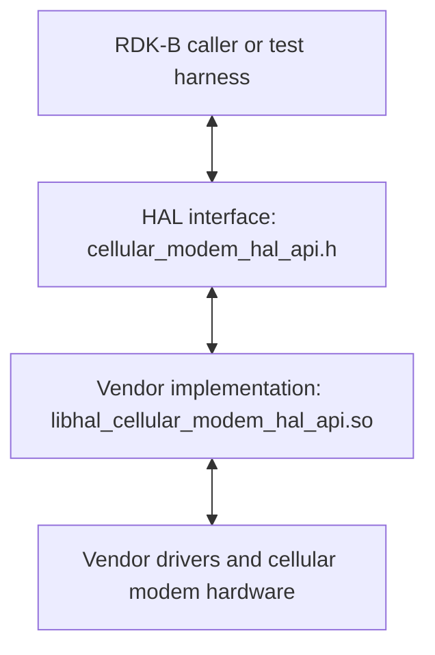
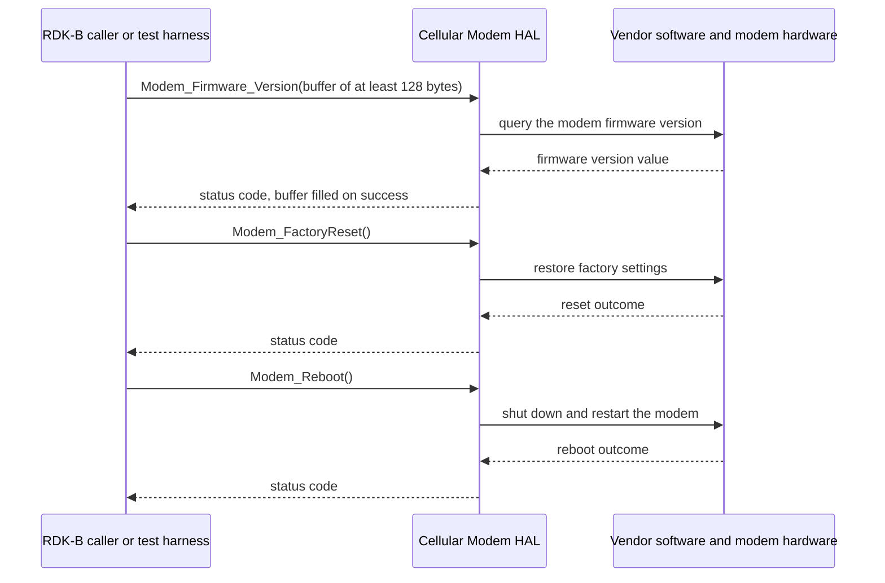

# Cellular Modem HAL Documentation

## Version History

| Date | Comment | Version |
| --- | --- | --- |
| 08/24/26 | Rewritten against the canonical HAL specification topic set, and renamed from `CellularModemHalSpec.md` to `halSpec.md`. Added `Version History`, `Optional Components`, `Data Structures and Defines`, `API Surface` and `State Diagram`. The API narrative was discarded and rebuilt from the header: the previous revision described seven functions and three types that this interface has never declared. | 1.0.1 |
| 06/10/24 | Initial release of the Cellular Modem HAL interface definition — `RDKB-52498`, migration of the Cellular Modem HAL header to GitHub, followed by refinement after MTA HAL review comments. | 1.0.0 |

Four version identities apply to this repository. They are deliberately kept apart, because a caller
needs a different one in each case and the previous revision of this page presented none of them.

| Identity | Value | What it is |
| --- | --- | --- |
| Document revision | `1.0.1` | The revision of this specification, as recorded in the table above. |
| Interface version | Not declared | `cellular_modem_hal_api.h` defines **no** interface version macro of any kind. A caller cannot determine, at compile time or at run time, which revision of this interface a platform was built against. The version reported by `Modem_Firmware_Version` is the **modem's firmware** version, not a version of this interface. |
| Release tag | `1.0.0` | The repository's only git tag, dated 10 June 2024, matching the single section in the changelog. This is the release this document describes. |
| Generated-site version string | `1.0.0-3-gf739a9a` | The output of `git describe --tags`, which `docs/generate_docs.sh` passes to the documentation generator as `PROJECT_VERSION`. It denotes the `1.0.0` tag plus three later commits, and is **not** a version. |

*Derived from `CHANGELOG.md`, the repository's git tags, `docs/generate_docs.sh`:26,
and `include/cellular_modem_hal_api.h`, searched in full — it declares no version macro.*

## Acronyms

- `HAL` \- Hardware Abstraction Layer
- `HALIF` \- HAL Interface
- `OEM` \- Original Equipment Manufacture
- `RDK` \- Reference Design Kit
- `RDK-B` \- Reference Design Kit for Broadband Devices
- `SLA` \- Service Level Agreement

*Bounded to the terms this document uses.*

## Description

The diagram below describes a high-level software architecture of the Cellular Modem HAL module
stack.

The Cellular Modem HAL abstracts the cellular modem hardware of an `RDK-B` device, so that a caller
can drive it without depending on a particular modem model or vendor. This repository carries the
**interface definition only**: `include/cellular_modem_hal_api.h` declares three functions, and each
vendor or `OEM` ships its own implementation behind them.

The interface covers modem management, and nothing else. Its scope is exactly the three capabilities
the header's own file-level description lists:

- **Factory reset** — return the modem to its default factory settings, discarding custom
  configuration.
- **Reboot** — shut the modem down and restart it cleanly.
- **Firmware version retrieval** — read the modem's current firmware version into a buffer the
  caller supplies.

Two boundaries decide whether this is the interface a caller wants. First, this HAL sits one layer
below cellular **network** access: attaching to the operator network, configuring modem power,
reading radio resource information and use of the subscriber identity module are recorded by the
`RDK-B` repository
inventory as the separate `rdkb-halif-cellular` interface, not as part of this one. Second, **no
dedicated `RDK-B` middleware service owns this interface** — the inventory lists no owning service
for Cellular Modem, which is why the diagram above shows the caller reaching the HAL directly rather
than through a service. The caller is whichever `RDK-B` component or test harness links the vendor
library.

Within those boundaries the Cellular Modem HAL is intended to be a shared resource, accessible and
usable by multiple `RDK-B` components and processes.

*Derived from `include/cellular_modem_hal_api.h`:20-31 for the capability list and :72, :90 and :103
for the declarations; from the `RDK-B` workspace repository inventory (`README.md`:29-30 for the
boundary against `rdkb-halif-cellular`, and its owning-service tables at :90-104 for the absence of
an owning service); and from the shared-resource statement retained from the previous revision of
this specification.*

## Optional Components

**No part of this interface is optional.** All three declared functions are unconditionally present:
the only preprocessor conditionals in the header are its include guard and the `__cplusplus` linkage
guard, so no build can remove any part of the surface. There is no optional callback registration a
caller may skip, and this repository declares no optional external daemon or library that a vendor
may substitute for part of the implementation.

A caller can therefore assume that a platform providing this HAL provides all three functions, and
does not have to test for a feature subset before calling one.

*Derived from `include/cellular_modem_hal_api.h`, searched in full: the include guard at :34-35 and
the `__cplusplus` guards at :40 and :105 are its only conditionals.*

## Component Runtime Execution Requirements

The requirements in this block apply to every implementation of this interface, and describe what a
caller may rely on at run time. Where this interface establishes nothing, the topic says so
explicitly rather than leaving a caller to infer a behaviour from a signature.

### Initialization and Startup

**This interface has no initialization or teardown entry point.** The header declares no init call,
no deinit call, no context or handle type and no session object. A caller invokes any of the three
functions directly, without opening or closing a session:

- `Modem_FactoryReset()`
- `Modem_Reboot()`
- `Modem_Firmware_Version()`

The client module has no explicit dependencies on other APIs for its core functionality. Third-party
vendors must implement this HAL to meet operational requirements, and a caller depends on that
implementation being present behind the header at link time.

**Blocking on hardware readiness:** this interface is designed to block execution if the underlying
cellular modem hardware is not ready for operation, which is what ensures resource availability
before a modem operation proceeds. A caller must expect a call to return only once the modem is
reachable, and must not treat a slow return as a failure. See "Blocking calls".

**Not specified by this interface:** nothing here states how long a call may block while waiting for
the hardware, or what a caller should do if the modem never becomes ready. A caller must not assume
a bound.

*Derived from the declarations at `include/cellular_modem_hal_api.h`:72, :90 and :103 — the complete
set, none of which initializes or tears down anything — together with the dependency and
hardware-readiness statements retained from the previous revision of this specification.*

### Threading Model

**This interface is not thread-safe.** Any module or component invoking its APIs must ensure thread
safety through external synchronization; the interface provides none, and declares no lock, handle
or context through which a caller could scope one.

Vendors may implement internal threading and event mechanisms within their software to meet their
operational requirements. Where they do, it is the vendor's responsibility to ensure those
mechanisms:

- **Synchronize access:** properly synchronize access to the Cellular Modem HAL APIs, so that
  concurrent use cannot cause a race condition or data corruption.
- **Clean up resources:** release every allocated resource — memory, threads, file handles — when
  the vendor software terminates or disconnects from the HAL.

Those are stated as vendor obligations because they are the contract the caller relies on: a caller
that serializes its own calls can only depend on that being sufficient if the implementation behind
the interface introduces no unsynchronized state of its own.

**Not specified by this interface:** it does not state that any individual function is re-entrant, so
a caller must serialize all calls to the interface rather than only calls to the same function.

*Derived from the thread-safety and vendor-responsibility statements retained from the previous
revision of this specification, and from `include/cellular_modem_hal_api.h`:72, :90 and :103, whose
signatures carry no synchronization primitive.*

### Process Model

All APIs are expected to be called from multiple processes. Because that access is concurrent,
vendors must implement protection mechanisms within their implementations to handle multiple
processes calling the same API simultaneously, which is what preserves data integrity and prevents
race conditions across process boundaries.

**Not specified by this interface:** it does not state whether `Modem_FactoryReset` or `Modem_Reboot`
may be called by one process while another process is inside a call, nor what the second caller
observes if that happens. A caller must not assume either behaviour.

*Derived from the multi-process statement retained from the previous revision of this specification,
and from `include/cellular_modem_hal_api.h`, which declares no cross-process serialization
mechanism.*

### Memory Model

This interface exchanges exactly one buffer, and its whole memory contract follows from that:
`Modem_Firmware_Version` writes the modem's firmware version into storage the caller supplies.
`Modem_FactoryReset` and `Modem_Reboot` take no arguments and exchange no memory at all.

#### Caller Responsibilities

- Allocate the buffer passed to `Modem_Firmware_Version` before the call. The header sets its minimum
  size at 128 bytes, sized for a value such as `EM06ALAR04A01M4G_01.003.01.003`.
- Own that buffer for its whole lifetime and release it afterwards. This interface never frees caller
  memory.
- Supply valid storage. The header names an invalid parameter among the reasons the call reports
  failure, so a caller can expect a failure code rather than a success code from a bad pointer; the
  header does not, however, require an implementation to detect one.
- Treat the buffer contents as valid only when the call reports success. **This interface does not
  state that the value written is NUL-terminated**, how many bytes are written, or whether anything
  is written when the call fails. A caller must not assume a terminated string; zeroing the buffer
  before the call and bounding every subsequent read by the allocated size is the only safe reading.

#### Module Responsibilities

- Confine the write to the storage the caller supplied. Because the header expresses the caller's
  obligation as a 128-byte minimum, an implementation whose version string needs more room than the
  caller allocated has no way to say so through this interface, and must not write past the buffer.
- Allocate and release internal memory for its own operational needs, and release all of it when the
  vendor software terminates or closes its connection to the HAL. Managing that memory is the
  vendor's sole responsibility.
- Retain no reference to the caller's pointer once the call has returned. Every call in this
  interface is synchronous and there is no callback, so no implementation has a reason to hold it.

*Derived from `include/cellular_modem_hal_api.h`:97 for the out-parameter and its 128-byte minimum,
:101 for invalid parameter as a failure reason, and :72 and :90 for the two argument-free calls,
together with the memory-ownership statements retained from the previous revision of this
specification.*

### Power Management Requirements

The Cellular Modem HAL is not involved in any power management operation. It neither participates in
nor requires involvement in power-related functions.

That is consistent with its surface, and the point is worth making explicitly: **no call in this
interface changes the modem's power state.** The previous revision of this specification described
modem power-up and power-down entry points that this interface has never declared; the `RDK-B`
repository inventory records modem power configuration as belonging to the separate
`rdkb-halif-cellular` interface. Power sequencing of the modem is not reachable through this HAL.

*Derived from the power-management statement retained from the previous revision of this
specification, from `include/cellular_modem_hal_api.h`:72, :90 and :103 — the complete set of
declarations, none of which controls power state — and from `README.md`:29 of the `RDK-B` workspace
inventory.*

### Asynchronous Notification Model

**There are no asynchronous notifications.** This interface declares no callback function-pointer
type, no registration function and no event or notification structure, so a caller cannot subscribe
to modem state changes through it.

Every call is therefore complete when it returns, and calling one of the three functions is the only
way to act on the modem through this interface. In particular, a caller is not notified when a modem
finishes restarting after `Modem_Reboot`, or when a `Modem_FactoryReset` has taken effect. See
"State Diagram" for the consequence.

*Derived from the no-notifications statement retained from the previous revision of this
specification, and from `include/cellular_modem_hal_api.h`, searched in full: it declares no
`typedef`, no function-pointer type and no registration function.*

### Blocking calls

**Synchronous and Responsive:** the Cellular Modem HAL APIs operate synchronously. Each call waits
for completion before returning a result, and that result is the return value — nothing completes
after the call returns. Response times are expected to align with the complexity of the requested
operation.

**Blocking on hardware readiness:** as "Initialization and Startup" records, this interface is
designed to block execution when the underlying cellular modem hardware is not ready for operation.
A caller must therefore expect any of the three calls to block, and must not issue one from a thread
that cannot tolerate being suspended. This is a deliberate property of **this** interface, and it
differs from other `RDK-B` HALs whose specifications require non-blocking calls; a caller must not
carry an assumption from one to the other.

**Timeout Handling:** for API calls susceptible to external delay or unresponsiveness,
implementations are required to apply appropriate timeout mechanisms rather than waiting
indefinitely.

**No completion-time or timeout target is specified for this interface.** Neither this repository nor
the header states a maximum duration for any of the three calls, a timeout value an implementation
must apply, or what a caller should do when a call does not return. `Modem_FactoryReset` and
`Modem_Reboot` in particular drive operations whose real duration is a property of the modem
hardware. A caller must not assume a bound, and a test author must not assert one.

*Derived from the synchronous-operation and timeout-handling statements retained from the previous
revision of this specification, and from `include/cellular_modem_hal_api.h`, which states no timing
requirement for any declaration.*

### Internal Error Handling

All Cellular Modem HAL APIs return errors synchronously as the return value, which gives the caller
immediate notification. The HAL is responsible for handling internal system errors — an
out-of-memory condition, for example — and for reporting them through that same return value rather
than through any other channel.

**This interface defines exactly two return codes,** and all three functions return one of them.

| Code | Value | Meaning |
| --- | --- | --- |
| `STATUS_SUCCESS` | `0` | The operation completed successfully. |
| `STATUS_FAILED` | `-1` | The operation did not complete. |

**A caller cannot determine why a call failed.** The failure code is a single undifferentiated value:
this interface has no error enumeration, no diagnostic out-parameter and no secondary status call.
The header's per-API documentation does list the reasons a call may fail — for a factory reset,
inability to access or modify configuration storage, insufficient permissions, hardware or firmware
problems, and interruption during the reset; for a reboot, inability to secure the necessary system
resources, failure in the initial shutdown phase, hardware or firmware problems, and security or
permission restrictions; for a firmware version read, an invalid parameter or a retrieval error —
but those are **descriptive prose, not distinct codes**, and a caller cannot recover them from the
return value.

The practical consequence is that a caller's failure handling is uniform across the interface: it
can retry, escalate or report, but it cannot branch on the cause. Diagnosing a cause means reading
the vendor log described under "Logging and debugging requirements".

*Derived from `include/cellular_modem_hal_api.h`:37 and :38 for the two macros, and :63-69, :81-87
and :99-101 for the per-API return documentation, together with the synchronous-error-reporting
statement retained from the previous revision of this specification.*

### Persistence Model

There is no requirement for the HAL to persist any setting information. This interface exposes
nothing to persist: two of its three calls are actions and the third is a read, and none of them
carries a configuration value.

`Modem_FactoryReset` is the one call whose effect is durable, and the durability is the modem's
rather than the HAL's — it discards the modem's custom configuration and restores factory settings.
Any state a calling application needs to survive that, or to survive a `Modem_Reboot`, is the
application's to persist.

*Derived from the persistence statement retained from the previous revision of this specification,
and from `include/cellular_modem_hal_api.h`:72, :90 and :103.*

## Non functional requirements

The following non-functional requirements apply to the Cellular Modem HAL component and to any
implementation of it.

### Logging and debugging requirements

The component is required to record all errors and critical informative messages, to aid in
identifying, debugging and understanding the functional flow of the system. Logging should be
implemented using the syslog method, which provides logging capabilities suited to system-level
software; the use of `printf` is discouraged unless syslog is not available.

All HAL components must adhere to a consistent logging process. When logging is necessary, it should
be performed into the `cellular_modem_vendor_hal.log` file, located in either the `/var/tmp/` or the
`/rdklogs/logs/` directory.

Logs must be categorized according to the following log levels, as defined by the Linux standard
logging system, listed here in descending order of severity:

- **FATAL:** Critical conditions, typically indicating system crashes or severe failures that require
  immediate attention.
- **ERROR:** Non-fatal error conditions that nonetheless significantly impede normal operation.
- **WARNING:** Potentially harmful situations that do not yet represent errors.
- **NOTICE:** Important but not error-level events.
- **INFO:** General informational messages that highlight system operations.
- **DEBUG:** Detailed information typically useful only when diagnosing problems.
- **TRACE:** Very fine-grained logging to trace the internal flow of the system.

Each log entry should include a timestamp, the log level and a message describing the event or
condition. That standard format is what makes log files parsable and comparable across vendors and
components.

This log is the only place a caller can recover the cause of a failure, because the return value
does not distinguish causes. See "Internal Error Handling".

*Derived from the logging requirements retained from the previous revision of this specification.*

### Memory and performance requirements

**No memory-footprint limit is specified for this interface.** This repository carries an interface
header and nothing else — no implementation, no build manifest and no product specification — so
there is no figure to state, and none is invented here. A platform integrator who needs a hard limit
must obtain it from the product specification rather than from this document.

**No completion-time or throughput target is specified either,** for the reasons set out under
"Blocking calls": the duration of a factory reset or a reboot is a property of the modem hardware,
and this interface states no bound on it.

What the interface does establish is the shape of the cost, and it is small: three calls, no polling
loop, no callback thread and exactly one caller-allocated buffer of at least 128 bytes. Nothing in
this interface runs unless a caller calls one of the three functions, so the interface itself adds no
idle cost. Whether a vendor implementation maintains background activity of its own is not specified
here.

*Derived from `include/cellular_modem_hal_api.h`:97 for the buffer, and from the repository contents,
verified in full: no `Makefile`, `CMakeLists.txt`, `configure.ac`, `Makefile.am` or Yocto recipe is
present.*

### Quality Control

To ensure the highest quality and reliability, it is strongly recommended that third-party quality
assurance tools such as `Coverity`, `Black Duck` and `Valgrind` be employed to analyze the
implementation thoroughly. The goal is to detect and resolve potential issues — memory leaks, memory
corruption or other defects — before deployment.

Both the HAL wrapper and any third-party software interacting with it must prioritize robust memory
management practices, including meticulous allocation, deallocation and error handling, to guarantee
stable and leak-free operation.

**Verification limit.** Cellular Modem is not available on the HUB6 or XER10 reference platforms, so
every runtime statement in this document is verified against the interface definition and this
repository's own stated policy, and is cited as such. None of it is reported as behaviour observed on
reference hardware, and a test author should treat the unspecified items named throughout as open
questions for the platform rather than as facts to assert.

**Keeping this document accurate.** Every topic here cites the file its content was derived from. Any
change to a cited source — principally `include/cellular_modem_hal_api.h`, `CHANGELOG.md` and
`docs/generate_docs.sh` — obliges a review of the topics that cite it. The reviewer for that
obligation is `@rdkcentral/rdkb-hal-advisory`, recorded by `.github/CODEOWNERS` as the owner of every
path in this repository.

*Derived from the quality-assurance statements retained from the previous revision of this
specification, from `.github/CODEOWNERS`, and from the reference-platform availability table of the
`RDK-B` workspace inventory (`README.md`:102-103).*

### Licensing

The implementation is expected to be released under the
[Apache License 2.0](https://www.apache.org/licenses/LICENSE-2.0), which is the licence this
repository itself carries — see the `LICENSE` and `NOTICE` files at the repository root, which are
also rendered into this documentation set as `LICENSE.md` and `NOTICE.md`.

*Derived from the licensing statement retained from the previous revision of this specification, and
from the repository's own `LICENSE` and the Apache-2.0 header carried by
`include/cellular_modem_hal_api.h`:1-18.*

### Build Requirements

The source code should be able to be built under a Linux Yocto environment, and should be delivered
as a shared library named `libhal_cellular_modem_hal_api.so`. A component or process consuming this
HAL includes `cellular_modem_hal_api.h` and adds a linker dependency on that library.

**What backs that requirement, stated plainly:** this repository ships the interface header only. It
contains no build manifest of any kind — no `Makefile`, no `CMakeLists.txt`, no `configure.ac`, no
`Makefile.am` and no Yocto recipe — so the library name and the environment above are requirements
placed on a vendor implementation, not something this repository builds. The one build script present,
`build_ut.sh`, clones the external unit-testing suite for the repository and does not build the HAL.
A caller obtains the contract from here and the library from its platform.

*Derived from the build statement retained from the previous revision of this specification, from
`build_ut.sh`:22-25, and from the repository contents, verified in full.*

### Variability Management

The role of adjusting the interface, guided by versioning, rests solely within architecture
requirements. Vendors are thereafter obliged to align their implementation with a designated version
of the interface; under `SLA` terms they may transition to newer versions as demand requires.

Each API interface is versioned using [Semantic Versioning 2.0.0](https://semver.org/), and vendor
code complies with a specific version of the interface.

**This interface declares no build-variability flag.** Every preprocessor conditional in the header
is either its include guard at :34-35 or the `__cplusplus` linkage guard at :40 and :105. No
compile-time flag adds or removes any part of the surface, so every build of this header exposes the
same three functions and the same two macros. A caller does not have to test for a feature subset,
and there is no flag whose effect this document could describe.

**And it declares no version macro.** A caller cannot read the interface version at compile time or
at run time; the only version identifiers that exist are external to the interface — the repository's
git tag and its changelog — and they are set out under "Version History". A test author must
therefore select expected behaviour from the platform's source revision rather than from a value read
through the interface.

*Derived from the versioning statements retained from the previous revision of this specification, and
from `include/cellular_modem_hal_api.h`:34-35, :40 and :105, searched in full for conditionals and
version macros.*

### Platform or Product Customization

**No platform or product customization is specified for this interface.** It exposes no configuration
file, no tunable, no environment variable and — as "Variability Management" records — no compile-time
flag, so there is nothing for a platform or product integrator to customize at this layer.

The variation this interface permits sits behind it rather than in it: the vendor library satisfying
the three declarations differs by modem and by platform, while the contract a caller compiles against
does not change.

*Derived from `include/cellular_modem_hal_api.h`, searched in full, and from the repository contents:
no configuration file is shipped.*

## Interface API Documentation

All HAL function prototypes and datatype definitions are available in the
[`cellular_modem_hal_api.h`](../../include/cellular_modem_hal_api.h) file.

1. Components/Process must include `cellular_modem_hal_api.h` to make use of Cellular Modem HAL
   capabilities.
2. Components/Process should add a linker dependency for `libhal_cellular_modem_hal_api.so`.

### Theory of operation and key concepts

The Cellular Modem HAL is the smallest kind of interface in `RDK-B`: three independent operations on
modem hardware, with no state of its own. There is nothing to create, nothing to open or close, and
no handle to carry between calls. A caller includes the header, links the vendor library and calls a
function; the implementation reaches the modem in whatever way its platform requires and reports the
outcome through the return value.

Two of the three operations are **actions** on the modem — `Modem_FactoryReset` and `Modem_Reboot` —
and the third, `Modem_Firmware_Version`, is a **read** that fills a caller-supplied buffer. That
division is the whole conceptual model of this interface.

#### Object Lifecycles

**There are no objects and no handles.** This interface declares no context type, no descriptor and
no structure of any kind, so there is nothing whose lifetime a caller manages across calls, and
nothing an implementation has to create before use or destroy afterwards.

The only resource with a lifecycle here is the firmware-version buffer, and it belongs to the caller:
the caller allocates it before `Modem_Firmware_Version`, reads it after a successful return, and
frees it when finished. The interface retains no reference to it. "Memory Model" states that contract
in full.

Because there is no context object there is also no notion of an instance. This interface addresses
*the* modem: no argument identifies which modem a call applies to, so a platform carrying more than
one cannot select between them through this interface.

*Derived from `include/cellular_modem_hal_api.h`:72, :90, :97 and :103 — the complete set of
declarations and the only parameter any of them takes.*

#### Method Sequencing

**This interface imposes no ordering.** There is no initialization to perform first and no teardown
to perform last, and each of the three functions is complete when it returns, so a caller may call
any of them at any time and in any order.

What the interface does not establish is what happens *around* the two state-changing calls.
`Modem_FactoryReset` and `Modem_Reboot` both make the modem unavailable for some period, and this
interface states neither how long that period is, nor how a caller learns that the modem is ready
again, nor whether a call issued during that window fails or blocks until the modem recovers. The one
adjacent statement this repository does make is that the interface blocks when the modem is not ready
for operation — see "Blocking calls" — and while a caller may find that suggestive, the interface
does not extend it to the post-reset and post-reboot windows, and a caller must not depend on it
doing so.

A caller that has to sequence work around a reset or a reboot must therefore obtain the readiness
signal from outside this interface, because nothing within it provides one.

*Derived from `include/cellular_modem_hal_api.h`:59-72 and :75-90 for what the two action calls state
about their own effects, and from the absence of any readiness or status declaration in the header.*

#### State-Dependent Behavior

The interface exposes no state and takes no state-dependent argument, so its declared behaviour does
not vary with state: every function is legal to call at any time, and each reports success or
failure.

The modem behind it plainly does have state, and the header acknowledges it only in the failure
reasons it lists — a factory reset can fail because configuration storage is inaccessible or because
the reset is interrupted; a reboot can fail because system resources cannot be secured or because the
initial shutdown phase fails. Those are the only state-dependent outcomes this interface documents,
and all of them arrive as the same undifferentiated failure code.

**Nothing beyond that is established.** This interface defines no state model, no readiness query and
no transition set. "State Diagram" records that gap rather than filling it.

*Derived from `include/cellular_modem_hal_api.h`:65-69 and :83-87 for the documented failure
conditions, and from the header's complete declaration set.*

### Data Structures and Defines

**This interface declares no enumerations, no structures and no typedefs.** The header was searched in
full: its only public definitions are the two macro constants below, and the only data crossing the
interface is a character buffer and an `int` return value. There is nothing for a caller to construct
and nothing to interpret beyond these two values.

**Macro constants.** Both are declared in
[`cellular_modem_hal_api.h`](../../include/cellular_modem_hal_api.h) and together form the complete
return-code vocabulary of this interface. Line numbers are given so a caller can go straight to the
declaration.

| Define | Declared at | What it represents |
| --- | --- | --- |
| `STATUS_SUCCESS` | :37 | The value `0`, returned when an operation completed successfully. Returned by all three functions. |
| `STATUS_FAILED` | :38 | The value `-1`, returned when an operation did not complete. Returned by all three functions, with no distinction between causes — see "Internal Error Handling". |

**The one buffer contract.** `Modem_Firmware_Version` takes a single `char *` out-parameter,
`firmware_version`, pointing at caller-allocated storage of at least 128 bytes, into which the
implementation writes the modem's firmware version — for example `EM06ALAR04A01M4G_01.003.01.003`.
This is not a declared type but a plain character buffer whose only stated constraint is that minimum
size; ownership, termination and the points this interface leaves unspecified are set out under
"Memory Model".

No other public type exists in this interface. A type name attributed to this HAL anywhere else
should be treated as an error: at the release this document describes,
`include/cellular_modem_hal_api.h` declares three functions and two macros, and nothing more.

*Derived from `include/cellular_modem_hal_api.h`:37, :38 and :97, and from the header searched in full
for `typedef`, `struct` and `enum` declarations — it carries none.*

### API Surface

All three declared functions are listed below by exact identifier, grouped by functional area.
Per-API detail — argument direction, the buffer minimum, the documented failure conditions and the
return-code list — is carried by the Doxygen block on each declaration in
[`include/cellular_modem_hal_api.h`](../../include/cellular_modem_hal_api.h), and the line numbers
below point at it.

All three functions return an `int` status code drawn from the two values under "Internal Error
Handling". None of them returns a value and none of them is `void`. `Modem_Firmware_Version` in
particular is **status-returning, not value-returning**: the firmware version leaves through its
out-parameter, while the return value reports only whether the read succeeded. Mistaking the two is
the easiest error to make against this interface.

**Modem maintenance:**

| API | Declared at | Purpose |
| --- | --- | --- |
| `Modem_FactoryReset` | :72 | Resets the modem to its default factory settings, erasing custom configuration and restoring every setting to its original state. Used to resolve a software problem, or to clear configuration before a new setup. Takes no arguments. |
| `Modem_Reboot` | :90 | Reboots the modem hardware, attempting a safe shutdown and restart so that all services restart cleanly. Used to apply new settings, or to recover from an unstable state. Takes no arguments. |

**Modem information:**

| API | Declared at | Purpose |
| --- | --- | --- |
| `Modem_Firmware_Version` | :103 | Reads the modem's current firmware version into the caller-allocated buffer named by its single `char *` out-parameter, which must be at least 128 bytes. |

This heading is the boundary of the two ways to read this document. Everything above it answers what
this interface is and how to call it; everything below it, together with "Non functional
requirements", carries the depth a caller needs when a call does not behave as expected.

*Derived from `include/cellular_modem_hal_api.h`:59-72, :74-90 and :92-103 — the three Doxygen blocks
and the declarations they document.*

### Sequence Diagram

The diagram shows all three calls in one sequence for compactness; it is not a required order, since
this interface imposes none. Each exchange is complete when the HAL returns — there is no callback
and no deferred completion — and the vendor leg of each exchange is whatever the implementation does
to reach the modem, which this interface does not constrain.

Both diagrams in this document are fenced Mermaid. They render on GitHub, which is the primary
surface for this specification because the repository's `README.md` is a symlink to it; they do not
render in the Doxygen-generated HTML, where the diagram source is displayed instead. That limitation
is stated rather than worked around, because the alternative form would break the surface a developer
actually reads.

*Derived from `include/cellular_modem_hal_api.h`:72, :90, :97 and :103; every identifier named in the
diagram is one this header declares.*

### State Diagram

**No state diagram is drawn for this interface, because it establishes no state transitions.** The
only enumerated values it defines are the two return statuses:

- `STATUS_SUCCESS` — the operation completed.
- `STATUS_FAILED` — the operation did not complete.

Those are outcomes of a call, not states of a modem, and **transitions are not specified by this
interface.**

The gap is worth naming precisely, because it is the first one a caller or test author meets.
`Modem_FactoryReset` and `Modem_Reboot` plainly change the modem's state — one discards its
configuration, the other takes it down and brings it back — and yet this interface:

- **defines no observable state.** There is no status query, no readiness call and no state argument
  anywhere in the three declarations, so a caller cannot read the modem's state through this HAL.
- **defines no transition set.** Nothing states which state a reset or a reboot leaves the modem in,
  or from which states either call is legal.
- **defines no post-reboot readiness contract.** Nothing states when the modem is usable again after
  `Modem_Reboot`, nor how a caller is meant to find out; there is no notification either, as
  "Asynchronous Notification Model" records.

A state machine drawn from two return codes would have to invent every edge, so none is drawn here. A
caller must not assume a state model, and a test author asserting post-reset or post-reboot behaviour
must take the expected transitions from the platform or the vendor rather than from this interface.
This gap is recorded for the interface owner named under "Quality Control" rather than filled in.

*Derived from `include/cellular_modem_hal_api.h`:37 and :38 for the two enumerated values, and from
the complete declaration set at :72, :90 and :103, which contains no state query and no transition
statement.*

