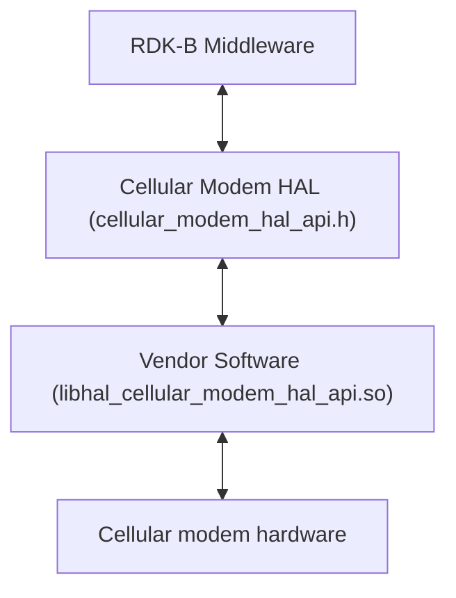
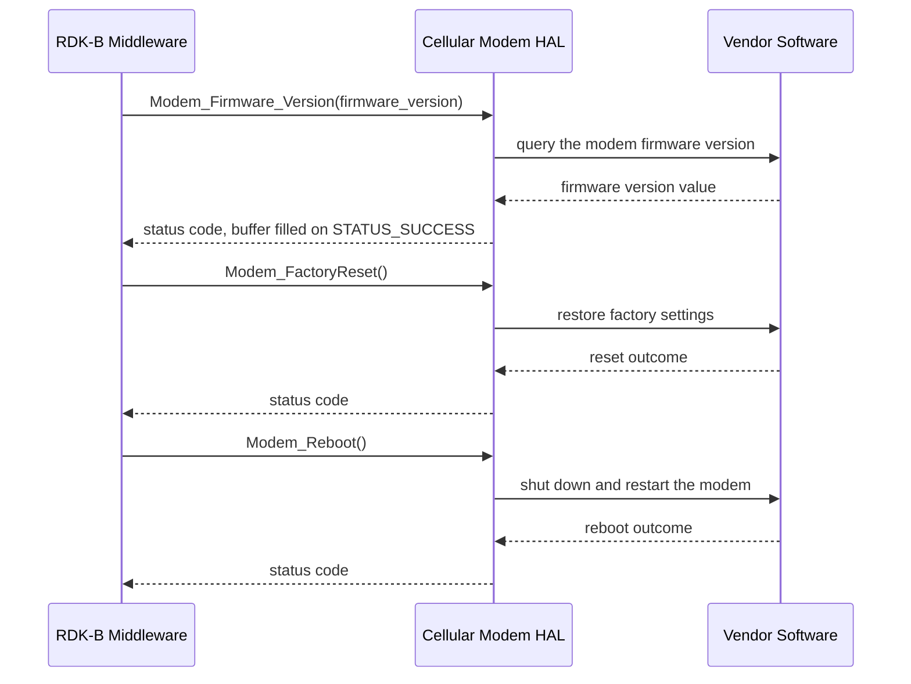

# Cellular Modem HAL Documentation

## Version History

| Date | Comment | Version |
| --- | --- | --- |
| 2024-06-10 | Initial release of the Cellular Modem HAL interface definition — `RDKB-52498`, migration of the Cellular Modem HAL header to GitHub, followed by refinement after MTA HAL review comments. | 1.0.0 |
| 2026-08-24 | Rewritten against the canonical HAL specification topic set, and renamed from `CellularModemHalSpec.md` to [halSpec.md](halSpec.md). Added `Version History`, `Optional Components`, `Data Structures and Defines`, `API Surface` and `State Diagram`. The API narrative was discarded and rebuilt from the header: the previous revision described seven functions and three types that this interface has never declared. | 1.0.1 |

## Acronyms

- `HAL` \- Hardware Abstraction Layer
- `OEM` \- Original Equipment Manufacturer
- `RDK` \- Reference Design Kit
- `RDK-B` \- Reference Design Kit for Broadband Devices
- `SLA` \- Service Level Agreement

## Description

The diagram below describes a high-level software architecture of the Cellular Modem HAL module
stack.

The Cellular Modem HAL abstracts the cellular modem hardware of an `RDK-B` device, so that a caller
can drive it without depending on a particular modem model or vendor. This repository carries the
interface definition only: `cellular_modem_hal_api.h` declares three functions, and each vendor or
`OEM` ships its own implementation behind them.

The interface covers modem management and exactly three capabilities:

- **Factory reset** — return the modem to its default factory settings, discarding custom
  configuration.
- **Reboot** — shut the modem down and restart it cleanly.
- **Firmware version retrieval** — read the modem's current firmware version into a buffer the
  caller supplies.

This HAL sits one layer below cellular network access: attaching to the operator network,
configuring modem power, reading radio resource information and using the subscriber identity
module belong to the separate `rdkb-halif-cellular` interface.

The caller is the RDK-B Middleware. No dedicated `RDK-B` middleware service owns this interface, so
any RDK-B Middleware component or process that links the vendor library calls the HAL directly, as
the diagram shows. The Cellular Modem HAL is a shared resource across those callers.

## Optional Components

No part of this interface is optional. A caller can rely on all three functions being present on
any platform that provides this HAL.

## Component Runtime Execution Requirements

The requirements in this block apply to every implementation of this interface, and describe what a
caller may rely on at run time.

### Initialization and Startup

This interface has no initialization or teardown entry point. A caller invokes any of the three
functions directly, without opening or closing a session:

- `Modem_FactoryReset()`
- `Modem_Reboot()`
- `Modem_Firmware_Version()`

The Cellular Modem HAL has no explicit dependencies on other APIs for its core functionality.
Third-party vendors must implement this HAL to meet operational requirements, and a caller depends
on that implementation being present behind the header at link time. A call made while the modem
hardware is not ready blocks rather than failing; see "Blocking calls".

### Threading Model

**This interface is not thread-safe.** Any module or component invoking its APIs must ensure thread
safety through external synchronization, serializing every call into the interface rather than only
concurrent calls to the same function.

Vendors may implement internal threading and event mechanisms within their software to meet their
operational requirements. Where they do, the vendor must:

- **Synchronize access:** properly synchronize access to the Cellular Modem HAL APIs, so that
  concurrent use cannot cause a race condition or data corruption.
- **Clean up resources:** release the threads, handles and other resources those mechanisms use when
  the vendor software terminates or disconnects from the HAL.

### Process Model

All APIs are expected to be called from multiple processes. Vendors must implement protection
mechanisms within their implementations to handle multiple processes calling the same API
simultaneously, preserving data integrity and preventing race conditions across process boundaries.

### Memory Model

The interface exchanges one buffer: `Modem_Firmware_Version` writes the modem's firmware version
into storage the caller supplies. `Modem_FactoryReset` and `Modem_Reboot` take no arguments and
exchange no memory.

#### Caller Responsibilities

- Pass `Modem_Firmware_Version` a valid, writable, non-`NULL` buffer of at least 128 bytes.
- Own that buffer; the interface never frees caller memory.
- Keep the buffer allocated and do not reuse it after the call returns; release or reuse it only
  once the vendor implementation confirms that it no longer uses the buffer.
- Read the buffer only after the call returns `STATUS_SUCCESS`, and discard its contents after
  `STATUS_FAILED`.
- Zero the buffer before the call, and bound every read of it by its allocated size rather than by
  a terminator.

#### Module Responsibilities

- Confine the write to the caller's buffer, within its 128-byte minimum.
- Allocate and release the memory the implementation needs internally, releasing all of it when the
  vendor software terminates or disconnects from the HAL. Managing that memory is the vendor's sole
  responsibility.

### Power Management Requirements

The Cellular Modem HAL is not involved in any power management operation. No call in this interface
changes the modem's power state.

### Asynchronous Notification Model

There are no asynchronous notifications. The interface declares no callback or registration
function, so every call is complete when it returns and a caller cannot subscribe to modem state
changes through it.

### Blocking calls

- **Synchronous and Responsive:** the Cellular Modem HAL APIs operate synchronously. Each call waits
  for completion before returning, and its result is the return value. Response times are expected
  to align with the complexity of the requested operation.
- **Blocking on hardware readiness:** the interface is designed to block execution while the
  underlying cellular modem hardware is not ready for operation, which ensures resource availability
  before a modem operation proceeds. Any of the three calls may therefore block. A caller must not
  issue one from a thread that cannot tolerate being suspended, and must not treat a slow return as a
  failure. This differs from `RDK-B` HALs whose specifications require non-blocking calls.
- **Timeout Handling:** for API calls susceptible to external delay or unresponsiveness,
  implementations must apply appropriate timeout mechanisms rather than waiting indefinitely.

### Internal Error Handling

All Cellular Modem HAL APIs return errors synchronously as the return value. The HAL is responsible
for handling internal system errors, such as an out-of-memory condition, and for reporting them
through that return value.

| Code | Meaning | Caller action |
| --- | --- | --- |
| `STATUS_SUCCESS` | The operation completed. | Proceed. After `Modem_Firmware_Version`, read the buffer; after `Modem_FactoryReset`, re-apply any modem setting the caller depends on. |
| `STATUS_FAILED` | The operation did not complete. | Do not assume the modem's configuration or operational state, and discard the firmware-version buffer. Log the failure, retry if appropriate, and escalate a persistent failure to the owner of the vendor implementation. |

The failure conditions each function's documentation lists, such as a hardware fault or an invalid
parameter, are descriptive rather than distinct codes: every failure returns `STATUS_FAILED`, so a
caller's failure handling is uniform across the interface. Diagnosing a cause means reading the
vendor log described under "Logging and debugging requirements".

### Persistence Model

There is no requirement for the HAL to persist any setting information. Any state a calling
application needs to survive a `Modem_FactoryReset` or a `Modem_Reboot` is the application's to
persist.

## Non functional requirements

The following non-functional requirements apply to the Cellular Modem HAL component and to any
implementation of it.

### Logging and debugging requirements

The component must record all errors and critical informative messages using syslog; `printf` is
discouraged unless syslog is not available.

- **Log file:** `cellular_modem_vendor_hal.log`, in either `/var/tmp/` or `/rdklogs/logs/`.
- **Log levels:** as defined by the Linux standard logging system, in descending order of severity:
  `FATAL`, `ERROR`, `WARNING`, `NOTICE`, `INFO`, `DEBUG`, `TRACE`.
- **Entry format:** each entry carries a timestamp, the log level and a message describing the event
  or condition.

Implementations must not log credentials, secrets, security-sensitive information, or other sensitive data.

### Memory and performance requirements

The interface itself adds little cost: three calls, no polling loop, no callback thread and one
caller-allocated buffer. Nothing in the interface runs unless a caller calls one of the three
functions.

### Quality Control

To ensure the highest quality and reliability, it is strongly recommended that third-party quality
assurance tools such as `Coverity`, `Black Duck` and `Valgrind` be employed to analyze the
implementation and resolve potential issues — memory leaks, memory corruption or other defects —
before deployment. Both the HAL wrapper and any third-party software interacting with it must
prioritize robust memory management practices, including meticulous allocation, deallocation and
error handling, to guarantee stable and leak-free operation.

Cellular Modem is not available on the HUB6 or XER10 reference platforms, so the runtime behaviour
this document describes has not been observed on reference hardware.

Any change to a file listed under "Source References" obliges a review of this document by the
repository's code owner, `@rdkcentral/rdkb-hal-advisory`.

### Licensing

The implementation is expected to be released under the
[Apache License 2.0](https://www.apache.org/licenses/LICENSE-2.0), the licence this repository
carries in its `LICENSE` and `NOTICE` files.

### Build Requirements

The vendor implementation should be built under a Linux Yocto environment and delivered as a shared
library named `libhal_cellular_modem_hal_api.so`.

### Variability Management

The role of adjusting the interface, guided by versioning, rests solely within architecture
requirements. Vendors are thereafter obliged to align their implementation with a designated version
of the interface; under `SLA` terms they may transition to newer versions as demand requires.

Each API interface is versioned using [Semantic Versioning 2.0.0](https://semver.org/spec/v2.0.0.html), and vendor
code complies with a specific version of the interface.

No compile-time flag varies the surface of this interface: every build exposes the same three
functions and two status macros.

### Platform or Product Customization

Platform and product variation sits behind this interface rather than in it. The vendor library
differs by modem and by platform, while the contract a caller compiles against is the same
everywhere.

## Interface API Documentation

All HAL function prototypes and datatype definitions are available in the
`cellular_modem_hal_api.h` file.

1. Components/Process must include `cellular_modem_hal_api.h` to make use of Cellular Modem HAL
   capabilities.
2. Components/Process should add a linker dependency for `libhal_cellular_modem_hal_api.so`.

### Theory of operation and key concepts

The Cellular Modem HAL is three independent operations on modem hardware, with no state of its own.
Two are **actions** on the modem — `Modem_FactoryReset` and `Modem_Reboot` — and the third,
`Modem_Firmware_Version`, is a **read** that fills a caller-supplied buffer. The implementation
reaches the modem in whatever way its platform requires and reports each outcome through the return
value.

#### Object Lifecycles

There are no objects and no handles, so a caller manages no lifetime across calls. The only
caller-managed resource is the firmware-version buffer described under "Memory Model".

No argument identifies a modem: every call applies to the platform's modem, and a platform carrying
more than one cannot select between them through this interface.

#### Method Sequencing

This interface imposes no ordering: a caller may call any of the three functions at any time and in
any order.

`Modem_Reboot` takes the modem down and restarts it, and `Modem_FactoryReset` replaces its
configuration. A caller that sequences work after either call obtains modem readiness from the
platform or the vendor.

#### State-Dependent Behavior

The interface exposes no state and takes no state-dependent argument. Modem conditions that prevent
an operation are reported as `STATUS_FAILED`: for `Modem_FactoryReset`, inaccessible configuration
storage or an interrupted reset; for `Modem_Reboot`, unavailable system resources or a failed
initial shutdown.

### Data Structures and Defines

The interface's only public definitions are the two status macros below, its complete return-code
vocabulary. The only other data crossing the interface is the character buffer
`Modem_Firmware_Version` fills, described under "Memory Model".

| Define | What it represents |
| --- | --- |
| `STATUS_SUCCESS` | The value `0`, the success status returned by all three functions. |
| `STATUS_FAILED` | The value `-1`, the single failure status returned by all three functions. |

### API Surface

All three declared functions are listed below by exact identifier, grouped by functional area.
Per-API detail — argument direction, the documented failure conditions and the return-code list —
is carried by the Doxygen block on each declaration in `cellular_modem_hal_api.h`.

All three return an `int` status code, one of the two values under "Internal Error Handling".
`Modem_Firmware_Version` returns the firmware version through its out-parameter, not through its
return value.

**Modem maintenance:**

| API | Purpose |
| --- | --- |
| `Modem_FactoryReset` | Resets the modem to its default factory settings, erasing custom configuration and restoring every setting to its original state. Used to resolve a software problem, or to clear configuration before a new setup. Takes no arguments. |
| `Modem_Reboot` | Reboots the modem hardware, attempting a safe shutdown and restart so that all services restart cleanly. Used to apply new settings, or to recover from an unstable state. Takes no arguments. |

**Modem information:**

| API | Purpose |
| --- | --- |
| `Modem_Firmware_Version` | Reads the modem's current firmware version into the caller-allocated buffer named by its single `char *` out-parameter, `firmware_version`. |

### Sequence Diagram

The RDK-B Middleware issues these three calls independently; they are shown in one diagram for
compactness.

### State Diagram

The interface's only enumerated values are the return statuses `STATUS_SUCCESS` and
`STATUS_FAILED`, which are outcomes of a call rather than states of the modem; the interface defines
no state transitions, so no state diagram is drawn.

## Source References

- [rdkcentral/rdkb-halif-cellular-modem/include/cellular_modem_hal_api.h](https://github.com/rdkcentral/rdkb-halif-cellular-modem/blob/develop/include/cellular_modem_hal_api.h) — interface header: the three functions, the two status macros and their Doxygen documentation
- [rdkcentral/rdkb-halif-cellular-modem/CHANGELOG.md](https://github.com/rdkcentral/rdkb-halif-cellular-modem/blob/develop/CHANGELOG.md) — release history
- [rdkcentral/rdkb-halif-cellular-modem/LICENSE](https://github.com/rdkcentral/rdkb-halif-cellular-modem/blob/develop/LICENSE) — Apache License 2.0
- [rdkcentral/rdkb-halif-cellular-modem/NOTICE](https://github.com/rdkcentral/rdkb-halif-cellular-modem/blob/develop/NOTICE) — copyright and licence notice
- [rdkcentral/rdkb-halif-cellular-modem/.github/CODEOWNERS](https://github.com/rdkcentral/rdkb-halif-cellular-modem/blob/develop/.github/CODEOWNERS) — repository code owner
